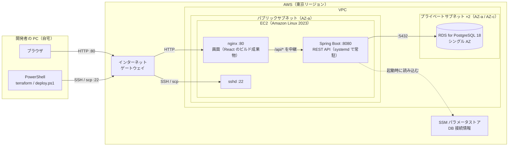
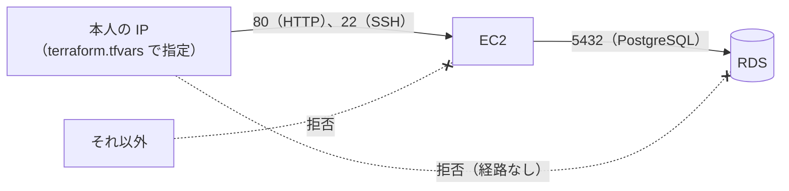
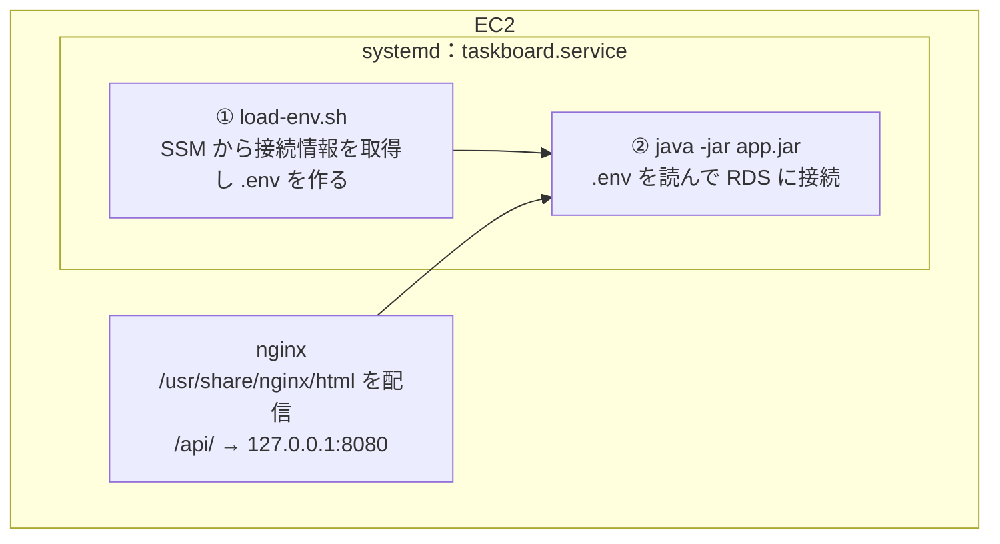
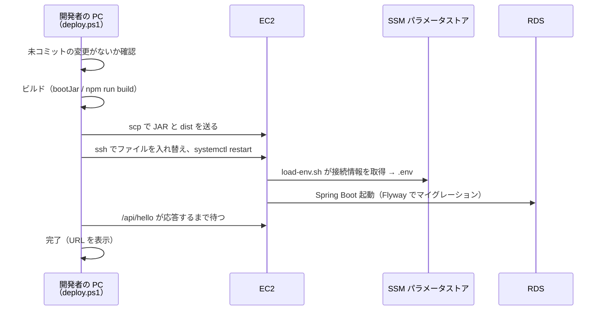

# インフラ設計書：Trello風タスク管理アプリ（AWS）

> 中央ドキュメント：[要件定義書.md](要件定義書.md)

本書は、アプリを AWS に公開するためのインフラ構成と、デプロイ・運用の手順をまとめたものです。
インスタンスタイプやポート番号などの細かい設定値は、コード（[terraform/](../terraform/)、[scripts/deploy.ps1](../scripts/deploy.ps1)）を正とします。

## 1. 方針

| 項目 | 方針 | 理由 |
|------|------|------|
| 規模 | 個人利用の最小構成（EC2 1台 + RDS） | 学習用途で、利用者は本人だけのため |
| 構築方法 | Terraform でコード化する（IaC） | 同じ環境を何度でも作り直せる。使わないときは `terraform destroy` で消して費用をかけない |
| 画面と API | 同じ EC2 で nginx が両方を受ける | フロントは相対パス `/api` を呼ぶ作りなので、同じ入口にすればコード変更も CORS 対応も不要 |
| ビルド | 手元の PC でビルドし、成果物を EC2 に送る | EC2（メモリ 1GB）でビルドせずに済み、EC2 には実行環境だけを入れればよい |
| DB | RDS for PostgreSQL（プライベートサブネット） | ローカルと同じ PostgreSQL 18。EC2 からしか接続できないようにする |
| アクセス制限 | セキュリティグループで本人の IP だけ許可する | アプリにログイン機能がないため、ネットワークで制限する |
| 秘密情報 | DB パスワードは Terraform で生成し、SSM パラメータストアに暗号化して置く | Git にもサーバー上の設定ファイルにも直書きしない |
| 使わないもの | ALB、CloudFront、S3、Elastic IP、NAT ゲートウェイ、CloudWatch Logs の設定 | 1台構成では不要で、費用がかかるため |

## 2. 全体構成図



- **リクエストの流れ**：ブラウザ → nginx。`/api/*` は nginx が Spring Boot（:8080）へ中継し、それ以外は React のビルド成果物（静的ファイル）を返す。
- **プライベートサブネットが 2 つある理由**：RDS は 2 つ以上の AZ のサブネットを必要とするため。シングル AZ 構成なので、実際に DB が動くのは EC2 と同じ AZ-a だけ。
- **パブリック IP**：EC2 に自動で割り当てる（Elastic IP は使わない）。停止 → 起動のたびに IP アドレスが変わる。

## 3. AWS リソース一覧

| 区分 | リソース | 役割 | 定義ファイル |
|------|------|------|------|
| ネットワーク | VPC、インターネットゲートウェイ | アプリ専用のネットワークと、インターネットへの出入口 | [vpc.tf](../terraform/vpc.tf) |
| | パブリックサブネット ×1 | EC2 を置く。インターネットゲートウェイへの経路あり | 〃 |
| | プライベートサブネット ×2 | RDS を置く。インターネットへの経路なし | 〃 |
| アクセス制御 | セキュリティグループ ×2 | EC2 用・RDS 用（「4. セキュリティ」を参照） | [security_groups.tf](../terraform/security_groups.tf) |
| サーバー | EC2 | nginx と Spring Boot を動かす | [ec2.tf](../terraform/ec2.tf) |
| | キーペア | SSH 用。手元の公開鍵を登録する（秘密鍵は AWS に渡さない） | 〃 |
| | IAM ロール | EC2 に「SSM パラメータの読み取り」と「Session Manager 接続」の権限を与える | 〃 |
| | user_data | 初回起動時のセットアップ（Java・nginx・psql のインストール、systemd 設定など） | [user_data.sh.tftpl](../terraform/user_data.sh.tftpl) |
| DB | RDS for PostgreSQL、サブネットグループ | アプリのデータを保存する | [rds.tf](../terraform/rds.tf) |
| 秘密情報 | SSM パラメータ（`/taskboard/db/*`） | DB の接続情報。パスワードだけ SecureString（暗号化） | 〃 |

## 4. セキュリティ

### 4.1 通信の許可（セキュリティグループ）



| 対象 | 受け付ける通信 | 送信元 |
|------|------|------|
| EC2 | HTTP（80） | 本人の IP だけ |
| EC2 | SSH（22） | 本人の IP だけ（不要になったらルールを消すだけで閉じられる） |
| RDS | PostgreSQL（5432） | EC2 のセキュリティグループが付いたサーバーだけ（IP ではなく SG で指定） |

- RDS は `publicly_accessible = false` でパブリック IP を持たない。ホスト名を引いても VPC 内のプライベート IP しか返らず、インターネットからは経路がない。
- 構築時に「EC2 からは接続できる」「手元の PC からは接続できない」ことを確認済み（2026-11-22）。

### 4.2 秘密情報の扱い

| 情報 | 置き場所 | Git |
|------|------|------|
| DB パスワード | Terraform が自動生成 → SSM パラメータストア（SecureString） | 入れない |
| 本人の IP、公開鍵のパス | `terraform/terraform.tfvars` | 入れない（`.gitignore`。ひな形は `terraform.tfvars.example`） |
| Terraform の state | `terraform/terraform.tfstate`（手元だけ） | 入れない（**DB パスワードが平文で含まれる**ため、人に渡さない） |
| EC2 上の `.env` | `/opt/taskboard/.env`（起動のたびに SSM から作り直す。本人しか読めない権限） | — |

### 4.3 既知の制約

- **HTTP のみ（HTTPS 未対応）**：通信は暗号化されない。本人の IP からしかアクセスできないため、学習用途として許容している。
- **認証なし**：アプリにログイン機能はない。アクセス制限は、セキュリティグループで IP を絞ることで代替している。

## 5. EC2 の中の構成



| 場所 | 内容 | 置く人 |
|------|------|------|
| `/usr/share/nginx/html/` | React のビルド成果物（`frontend/dist` の中身） | deploy.ps1 |
| `/opt/taskboard/app.jar` | Spring Boot の実行可能 JAR | deploy.ps1 |
| `/opt/taskboard/load-env.sh` | SSM から `.env` を作るスクリプト | user_data |
| `/opt/taskboard/.env` | DB 接続情報（`DB_HOST` などアプリの環境変数名） | load-env.sh（起動のたび） |
| `/etc/systemd/system/taskboard.service` | Spring Boot の常駐設定（OS 起動時に自動起動） | user_data |

- アプリの `application.properties` は、作業ディレクトリの `.env` を読み込む設定になっている。そのため、ローカル開発と同じ仕組みのまま、AWS でもコードを変えずに動く。
- DB のスキーマとテストデータは、アプリの起動時に Flyway が RDS に適用する。

## 6. 構築・デプロイ・運用の手順

### 6.1 前提（手元の PC）

| ツール | 用途 |
|------|------|
| AWS CLI v2 | 認証情報の設定（`aws configure`）、リソースの確認 |
| Terraform | インフラの構築・削除 |
| JDK 25 / Node.js 22 | アプリのビルド（JDK 25 は Gradle が自動で用意する） |
| OpenSSH（ssh / scp） | EC2 への接続・ファイル転送（Windows 11 に標準で入っている） |

### 6.2 初回の準備

```powershell
cd terraform
copy terraform.tfvars.example terraform.tfvars   # 本人の IP と公開鍵のパスを書く
terraform init
```

本人の IP は `(Invoke-RestMethod https://checkip.amazonaws.com).Trim()` で調べられる（末尾に `/32` を付けて書く）。

### 6.3 構築（terraform apply）

```powershell
cd terraform
terraform apply      # 約 6 分（大半は RDS の作成待ち）
terraform output     # アクセス先の URL、SSH のコマンドなど
```

EC2 のセットアップ（user_data）は起動から 1〜2 分で終わる。

### 6.4 デプロイ（scripts/deploy.ps1）

```powershell
.\scripts\deploy.ps1
```



- 手元のコードがそのままデプロイされるため、未コミットの変更があると止まる（試すときだけ `-AllowDirty` で無視できる）。
- 1 回のデプロイは 1 分ほど。

### 6.5 停止・削除

| やりたいこと | コマンド | 費用 |
|------|------|------|
| しばらく使わない（数日以上） | `terraform destroy` | 0 円（次回は apply → deploy で元に戻る。**DB のデータは消える**） |
| 少しの間だけ止める | `aws ec2 stop-instances --instance-ids <ID>` | EC2 は止まるが、RDS は動き続ける |

- RDS は停止しても 7 日で自動的に起動するため、長く使わないときは `terraform destroy` が確実。
- 自動バックアップは無効にしているため、destroy すると DB のデータは残らない（非機能要件どおり）。

### 6.6 よくあるトラブル

| 症状 | 原因と対処 |
|------|------|
| ブラウザも SSH もつながらない | 自宅の IP が変わった。`terraform.tfvars` の `my_ip_cidr` を直して `terraform apply` |
| 停止 → 起動後に IP がわからない | `terraform apply -refresh-only` のあと `terraform output` |
| SSH で「REMOTE HOST IDENTIFICATION HAS CHANGED」 | 作り直した EC2 が以前と同じ IP になった。`ssh-keygen -R <IP>` で古い記録を消す |
| デプロイ後に `/api/hello` が応答しない | `ssh ec2-user@<IP> sudo journalctl -u taskboard -n 100 --no-pager` でアプリのログを見る |
| user_data がうまく動いたか知りたい | `ssh ec2-user@<IP> sudo cat /var/log/cloud-init-output.log` |

## 7. 費用の目安（東京リージョン・常時稼働した場合）

| 項目 | 月額の目安 |
|------|------|
| RDS（db.t4g.micro + ストレージ 20GB） | 約 $20 |
| EC2（t3.micro + ディスク 20GB） | 約 $12 |
| パブリック IPv4 アドレス | 約 $3.6 |
| 合計 | **約 $35** |

使うときだけ `terraform apply` し、終わったら `terraform destroy` する運用にすれば、数時間の利用で数十円程度に収まる。
