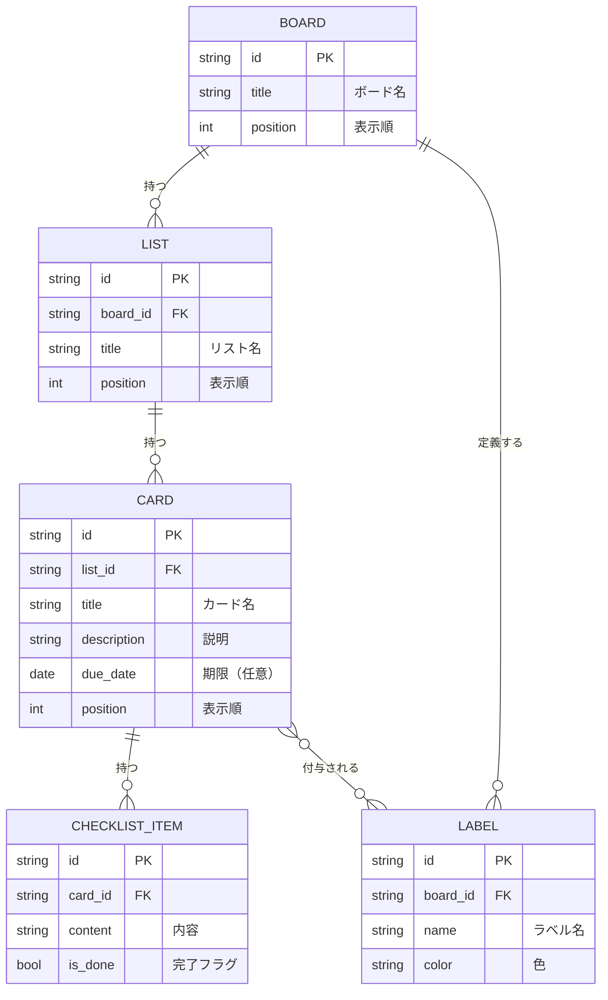

# データ設計書：Trello風タスク管理アプリ

> 中央ドキュメント：[要件定義書.md](要件定義書.md)

## 1. データ項目（概要）

- **ボード**：タイトル
- **リスト**：タイトル、並び順、所属ボード
- **カード**：タイトル、説明、並び順、所属リスト、期限、ラベル、チェック項目
- **ラベル**：名称、色
- **チェック項目**：内容、完了フラグ

## 2. ER図

| 関係 | 意味 |
|------|------|
| BOARD → LIST（1対多） | 1つのボードに複数リスト |
| LIST → CARD（1対多） | 1つのリストに複数カード |
| CARD → CHECKLIST_ITEM（1対多） | 1枚のカードに複数のチェック項目 |
| BOARD → LABEL（1対多） | ラベルはボード単位で定義（ボード内で共有） |
| CARD ⇄ LABEL（多対多） | 1枚のカードに複数ラベル、1つのラベルは複数カードに付く |

※ 多対多（CARD ⇄ LABEL）の実装方法（中間テーブル等）や詳細な型・テーブル定義は「データ設計」フェーズで確定する。
