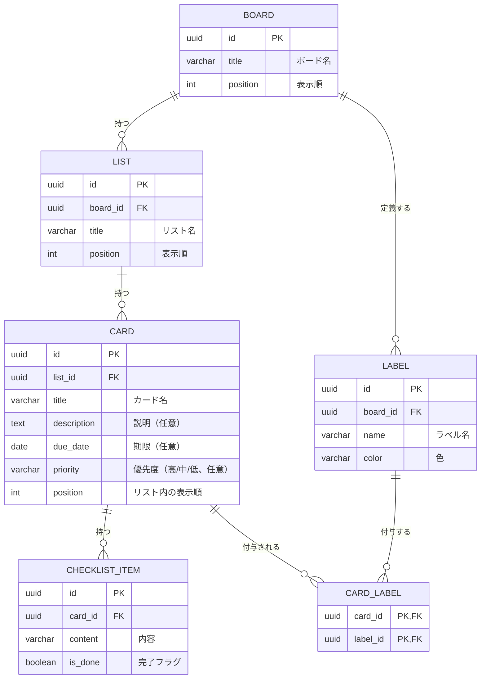

# データ設計書：Trello風タスク管理アプリ

> 中央ドキュメント：[要件定義書.md](要件定義書.md)

## 1. データ項目（概要）

- **ボード**：タイトル、並び順
- **リスト**：タイトル、並び順、所属ボード
- **カード**：タイトル、説明、並び順、所属リスト、期限、優先度、チェック項目
- **チェック項目**：内容、完了フラグ
- **ラベル**：名称、色（**将来拡張**。テーブルは作成済みだが、現在は使っていない）

## 2. ER図

| 関係 | 意味 |
|------|------|
| BOARD → LIST（1対多） | 1つのボードに複数リスト |
| LIST → CARD（1対多） | 1つのリストに複数カード |
| CARD → CHECKLIST_ITEM（1対多） | 1枚のカードに複数のチェック項目 |
| BOARD → LABEL（1対多） | ラベルはボード単位で定義する（将来拡張） |
| CARD ⇄ LABEL（多対多） | 中間テーブル CARD_LABEL で表す（将来拡張） |

## 3. テーブル定義

正となる定義は Flyway のマイグレーション [V1__create_initial_schema.sql](../backend/src/main/resources/db/migration/V1__create_initial_schema.sql) を参照。
ID はすべて UUID で、`gen_random_uuid()` により採番する。

### board（ボード）

| カラム | 型 | 制約 | 説明 |
|------|------|------|------|
| id | UUID | PK | |
| title | VARCHAR(255) | NOT NULL | ボード名 |
| position | INTEGER | NOT NULL | 表示順 |

### list（リスト）

| カラム | 型 | 制約 | 説明 |
|------|------|------|------|
| id | UUID | PK | |
| board_id | UUID | NOT NULL, FK → board(id) ON DELETE CASCADE | 所属ボード |
| title | VARCHAR(255) | NOT NULL | リスト名 |
| position | INTEGER | NOT NULL | 表示順 |

### card（カード）

| カラム | 型 | 制約 | 説明 |
|------|------|------|------|
| id | UUID | PK | |
| list_id | UUID | NOT NULL, FK → list(id) ON DELETE CASCADE | 所属リスト |
| title | VARCHAR(255) | NOT NULL | カード名 |
| description | TEXT | | 説明（任意） |
| due_date | DATE | | 期限（任意） |
| priority | VARCHAR(10) | CHECK (priority IN ('高', '中', '低')) | 優先度（任意） |
| position | INTEGER | NOT NULL | リスト内の表示順（0始まり。移動・並べ替え時に詰め直す） |

### checklist_item（チェック項目）

| カラム | 型 | 制約 | 説明 |
|------|------|------|------|
| id | UUID | PK | |
| card_id | UUID | NOT NULL, FK → card(id) ON DELETE CASCADE | 所属カード |
| content | VARCHAR(255) | NOT NULL | 内容 |
| is_done | BOOLEAN | NOT NULL, DEFAULT FALSE | 完了フラグ |

### label（ラベル）※将来拡張・現在未使用

| カラム | 型 | 制約 | 説明 |
|------|------|------|------|
| id | UUID | PK | |
| board_id | UUID | NOT NULL, FK → board(id) ON DELETE CASCADE | 所属ボード |
| name | VARCHAR(100) | NOT NULL | ラベル名 |
| color | VARCHAR(20) | NOT NULL | 色 |

### card_label（カード⇄ラベルの中間テーブル）※将来拡張・現在未使用

| カラム | 型 | 制約 | 説明 |
|------|------|------|------|
| card_id | UUID | PK, FK → card(id) ON DELETE CASCADE | |
| label_id | UUID | PK, FK → label(id) ON DELETE CASCADE | |

### インデックス

外部キー列に、親からの絞り込み用インデックスを作成している。

| インデックス | 対象 |
|------|------|
| idx_list_board_id | list(board_id) |
| idx_card_list_id | card(list_id) |
| idx_label_board_id | label(board_id) |
| idx_checklist_card_id | checklist_item(card_id) |
| idx_card_label_label_id | card_label(label_id) |

## 4. マイグレーションと固定データ

| バージョン | ファイル | 内容 |
|------|------|------|
| V1 | `V1__create_initial_schema.sql` | 全テーブル・インデックスの作成 |
| V2 | `V2__seed_test_data.sql` | ボード1件・リスト2件（ToDo／Doing）・動作確認用カード5件 |
| V3 | `V3__add_done_list.sql` | Done リストの追加 |

ボードとリストは画面から追加・変更しないため、固定 UUID で投入している。フロントエンドの [lists.ts](../frontend/src/lists.ts) はこの UUID でリスト名を引いている。

| 種別 | 名前 | id | position |
|------|------|------|------|
| ボード | マイボード | `11111111-1111-1111-1111-111111111111` | 0 |
| リスト | ToDo | `22222222-2222-2222-2222-222222222201` | 0 |
| リスト | Doing | `22222222-2222-2222-2222-222222222202` | 1 |
| リスト | Done | `22222222-2222-2222-2222-222222222203` | 2 |
