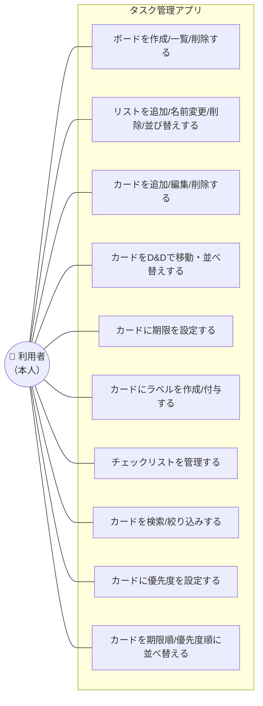

# 機能要件：Trello風タスク管理アプリ

> 中央ドキュメント：[要件定義書.md](要件定義書.md)

ユーザーがアプリで行える操作（ユースケース）と、実装すべき機能の一覧を定義する。

## 1. ユースケース図

利用者（本人）がアプリで行える操作の一覧。

## 2. 機能要件

| ID | 分類 | 機能 | 概要 |
|----|------|------|------|
| F-01 | ボード | 作成 | 新しいボードを作成できる |
| F-02 | ボード | 一覧表示 | 作成済みボードを一覧で表示できる |
| F-03 | ボード | 削除 | ボードを削除できる |
| F-04 | リスト | 追加 | ボード内にリストを追加できる |
| F-05 | リスト | 名前変更 | リスト名を変更できる |
| F-06 | リスト | 削除 | リストを削除できる |
| F-07 | リスト | 並び替え | リストの表示順を変更できる |
| F-08 | カード | 追加 | リスト内にカードを追加できる |
| F-09 | カード | 編集 | カードのタイトル・内容を編集できる |
| F-10 | カード | 削除 | カードを削除できる |
| F-11 | カード | D&D移動 | カードをリスト内・リスト間でドラッグ移動できる |
| F-12 | カード | 詳細表示 | カードをクリックすると詳細を開ける |
| F-13 | 期限 | 設定・表示 | カードに期限日を設定・表示できる。期限が近い/過ぎたら強調表示 |
| F-14 | ラベル | 作成・付与 | 色付きラベルをボード単位で作成（名称＋色を指定）し、カードに付与・解除・表示できる |
| F-15 | チェックリスト | 管理 | カード内に小タスクを追加・チェックでき、進捗率を表示する |
| F-16 | 検索 | 検索/絞り込み | キーワードやラベルでカードを検索・絞り込みできる |
| F-17 | 優先度 | 設定・表示 | カードに優先度（高／中／低）を設定・表示できる |
| F-18 | カード | 並べ替え | リスト内のカードを期限順・優先度順に並べ替えできる（未設定は末尾） |

> 各機能に対応する画面・操作は [画面設計書.md](画面設計書.md) を参照。
