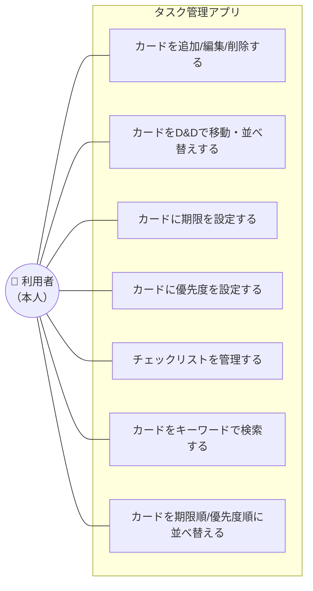

# 機能要件：Trello風タスク管理アプリ

> 中央ドキュメント：[要件定義書.md](要件定義書.md)

ユーザーがアプリで行える操作（ユースケース）と、実装すべき機能の一覧を定義する。

## 1. ユースケース図

利用者（本人）がアプリで行える操作の一覧（今回のスコープのみ）。

## 2. 機能要件

状態の意味：**実装済み** ／ **未実装**（今回のスコープで、これから実装する） ／ **将来拡張**（今回は作らない）

> F番号は、これまでのコミットや Issue との対応を保つため振り直さずに残している。

| ID | 分類 | 機能 | 概要 | 状態 |
|----|------|------|------|------|
| F-01 | ボード | 作成 | 新しいボードを作成できる | 将来拡張 |
| F-02 | ボード | 一覧表示 | 作成済みボードを一覧で表示できる | 将来拡張 |
| F-03 | ボード | 削除 | ボードを削除できる | 将来拡張 |
| F-04 | リスト | 追加 | ボード内にリストを追加できる | 将来拡張 |
| F-05 | リスト | 名前変更 | リスト名を変更できる | 将来拡張 |
| F-06 | リスト | 削除 | リストを削除できる | 将来拡張 |
| F-07 | リスト | 並び替え | リストの表示順を変更できる | 将来拡張 |
| F-08 | カード | 追加 | リスト下の「＋ カード追加」からモーダルを開き、カードを追加できる | 実装済み |
| F-09 | カード | 編集 | カード詳細モーダルで、タイトル・説明・期限・優先度を編集して保存できる | 実装済み |
| F-10 | カード | 削除 | カード詳細モーダルから、確認のうえカードを削除できる | 未実装 |
| F-11 | カード | 移動 | カードをリスト内・リスト間でドラッグ移動できる。モーダルのリスト選択でも移動できる | 実装済み |
| F-12 | カード | 詳細表示 | カードをクリックすると詳細モーダルを開ける | 実装済み |
| F-13 | 期限 | 設定・表示 | カードに期限日を設定・表示できる。今日から3日以内は黄色、期限切れは赤で強調表示する | 実装済み |
| F-14 | ラベル | 作成・付与 | 色付きラベルをボード単位で作成（名称＋色を指定）し、カードに付与・解除・表示できる | 将来拡張 |
| F-15 | チェックリスト | 管理 | カード内に小タスクを追加・チェック・削除でき、進捗（完了数/全体数）を表示する | 実装済み |
| F-16 | 検索 | キーワード検索 | キーワードでカードのタイトル・説明を部分一致検索し、該当カードだけを表示する（ラベルでの絞り込みは将来拡張） | 実装済み |
| F-17 | 優先度 | 設定・表示 | カードに優先度（高／中／低）を設定・表示できる | 実装済み |
| F-18 | カード | 並べ替え | リスト内のカードを期限順・優先度順に並べ替えできる。押すたびに昇順/降順を切り替え、未設定は末尾。結果はDBに保存する | 実装済み |

> 各機能に対応する画面・操作は [画面設計書.md](画面設計書.md) を参照。
