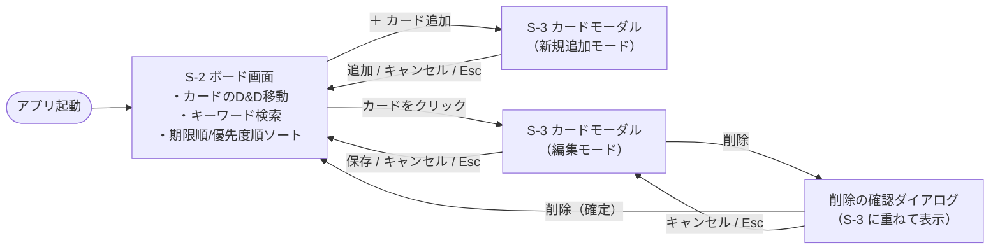

# 画面設計書：Trello風タスク管理アプリ

> 中央ドキュメント：[要件定義書.md](要件定義書.md) ／ 対応する機能一覧：[機能要件.md](機能要件.md)

## 1. 画面一覧

| No | 画面名 | 種別 | 役割 |
|----|--------|------|------|
| S-2 | ボード画面 | ページ | アプリの入口。リストとカードを表示。カードのD&D移動・追加・検索・並べ替え |
| S-3 | カードモーダル | モーダル | カードの追加（新規追加モード）と、詳細の表示・編集（編集モード）。S-2 に重ねて表示 |

> S-1 ボード一覧画面は、複数ボード管理（F-01〜03）とともに**将来拡張**とした。画面番号は当初の設計との対応を保つため S-2／S-3 のまま残している。

## 2. 画面遷移図



## 3. ワイヤーフレーム

### S-2 ボード画面

```
┌──────────────────────────────────────────────────────────────┐
│  Trello風タスク管理                   🔍[ カードを検索...    ] │ ← ヘッダー（アプリ名／キーワード検索）
├──────────────────────────────────────────────────────────────┤
│                                                              │
│  ┌─ ToDo ─────────┐  ┌─ Doing ────────┐  ┌─ Done ─────────┐   │
│  │   📅↕ ⚑↕  3    │  │   📅↕ ⚑↕  1    │  │   📅↕ ⚑↕  0    │ ← 並べ替えボタン／件数
│  │                │  │                │  │                │   │
│  │ ┌────────────┐ │  │ ┌────────────┐ │  │                │   │
│  │ │資料作成  [高]│ │  │ │設計    [中]│ │  │  カードなし     │ ← 空のときの表示
│  │ │提案資料を…  │ │  │ │☑ 2/5       │ │  │                │   │
│  │ │📅 11/12     │ │  │ └────────────┘ │  │                │   │
│  │ └────────────┘ │  │                │  │                │   │
│  │ ┌────────────┐ │  │                │  │                │   │
│  │ │見積依頼     │ │  │                │  │                │   │
│  │ └────────────┘ │  │                │  │                │   │
│  │                │  │                │  │                │   │
│  │ ＋ カード追加   │  │ ＋ カード追加   │  │ ＋ カード追加   │ ← カード追加（検索中は非表示）
│  └────────────────┘  └────────────────┘  └────────────────┘   │
└──────────────────────────────────────────────────────────────┘
          ↑ カードはリスト内・リスト間を D&D で移動できる
```

| 要素 | 操作 | 動き | 対応機能 |
|------|------|------|----------|
| 🔍 検索 | 入力 | タイトル・説明の部分一致でカードを絞り込む（入力後300msで検索） | F-16 |
| リスト見出し [📅↕] | クリック | リスト内カードを期限順に並べ替え（初回は昇順、押すたびに昇順/降順を切替）。結果を保存。検索中は押せない | F-18 |
| リスト見出し [⚑↕] | クリック | リスト内カードを優先度順に並べ替え（初回は高い順、押すたびに高い順/低い順を切替）。結果を保存。検索中は押せない | F-18 |
| リスト見出しの数字 | 表示 | リスト内のカード件数 | － |
| [ ＋ カード追加 ] | クリック | **S-3**（新規追加モード）を開く。押したリストが初期選択される | F-08 |
| カード | クリック | **S-3**（編集モード）を開く | F-12 |
| カード | D&D | リスト内の並べ替え・リスト間の移動。検索中はドラッグできない | F-11 |
| カード上の表示 | 表示 | タイトル / 優先度バッジ / 説明 / 📅期限 / ☑チェック進捗 | F-13, 15, 17 |

**カード表示のルール**

- 📅 期限：今日から**3日以内**＝黄色、**過ぎた**＝赤で強調（F-13）
- ☑ チェック項目がある場合、「完了数/全体数」で進捗を表示（F-15）
- 優先度バッジは 高／中／低 で色分け（F-17）
- 並べ替えボタンは、リスト内のカードが2枚未満のとき押せない
- 検索中は、カードのD&Dと並べ替えボタンを無効にする（絞り込まれたカードだけでは、リスト全体での正しい並び順を決められないため）
- 検索中に該当カードがないリストは「該当なし」と表示する

### S-3 カードモーダル

```
      ┌──────────────────────────────────────────────┐
      │  カード詳細                            [ × ]  │ ← 見出し（新規追加モードは「カードを追加」）／閉じる
      ├──────────────────────────────────────────────┤
      │  タイトル                                     │
      │  [ 資料作成                               ]  │
      │  リスト（状態）                               │
      │  [ ToDo                                 ▼ ]  │
      │  優先度                                       │
      │  [ 高                                   ▼ ]  │
      │  説明                                         │
      │  [ クライアント向けの提案資料をまとめる     ]  │
      │  [                                        ]  │
      │  期限                                         │
      │  [ 2026/11/12 ]                              │
      │                                              │
      │  チェックリスト                          2/5  │
      │  [■■■■■■■■□□□□□□□□□□□□]                     │ ← 進捗バー
      │   ☑ 構成案を作る                       [×]   │
      │   ☑ 素材を集める                       [×]   │
      │   ☐ 本文を書く                         [×]   │ ← 各項目チェック/削除
      │  [ 項目を追加...              ] [ ＋ 追加 ]   │
      │                                              │
      │  [ 削除 ]                [キャンセル] [ 保存 ] │ ← ［削除］は編集モードのみ表示
      └──────────────────────────────────────────────┘
          （背景は S-2 ボード画面が薄暗く見えている）
```

| 要素 | 操作 | 動き | 対応機能 |
|------|------|------|----------|
| タイトル | 入力 | カード名（必須。空のときは保存できない） | F-08, 09 |
| リスト（状態） | 選択 | 所属リストを選ぶ（ToDo／Doing／Done） | F-11 |
| 優先度 | 選択 | なし／高／中／低 を設定 | F-17 |
| 説明 | 入力 | 説明（任意・複数行） | F-09 |
| 期限 | 日付選択 | 期限を設定（任意） | F-13 |
| チェック項目 ☑ | クリック | 完了/未完了を切替え、進捗を更新（即時保存） | F-15 |
| チェック項目 [×] | クリック | 項目を削除（即時保存） | F-15 |
| [ ＋ 追加 ] / Enter | クリック / 入力 | チェック項目を追加（即時保存） | F-15 |
| [ 削除 ] | クリック | 確認ダイアログを開く（編集モードのみ）。確定するとカードを削除して **S-2** へ戻る | F-10 |
| [ 追加 ] / [ 保存 ] | クリック | 入力内容を保存してモーダルを閉じる。盤面は該当カードだけを更新する | F-08, 09 |
| [ キャンセル ] / [ × ] / Esc / 背景クリック | 操作 | 保存せずにモーダルを閉じる | F-12 |

**モードによる違い**

- **新規追加モード**：見出しは「カードを追加」、ボタンは［追加］。カードがまだないため、チェック項目は画面内に溜めておき、カード作成後にまとめて登録する（進捗バーは表示しない）
- **編集モード**：見出しは「カード詳細」、ボタンは［保存］。チェック項目の追加・切替・削除はその場で保存される。左下に［削除］を表示する

### 削除の確認ダイアログ

S-3（編集モード）の［削除］を押すと、S-3 の上に重ねて表示する（非機能要件「誤操作防止」に対応）。

```
      ┌──────────────────────────────────────┐
      │  このカードを削除しますか？            │
      │  この操作は取り消せません。            │
      │                                      │
      │              [キャンセル] [ 削除 ]    │
      └──────────────────────────────────────┘
```

| 要素 | 操作 | 動き | 対応機能 |
|------|------|------|----------|
| [ 削除 ] | クリック | カードを削除し（チェック項目も併せて削除）、ダイアログと S-3 を閉じて **S-2** へ戻る。盤面からは該当カードだけを除去する。処理中は「削除中...」と表示し、操作できない | F-10 |
| [ キャンセル ] / Esc / 背景クリック | 操作 | ダイアログだけを閉じて S-3 に戻る（処理中は閉じない） | F-10 |
| エラー表示 | 表示 | 削除に失敗した場合は、ダイアログ内にエラーメッセージを表示する | F-10 |
