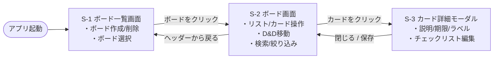

# 画面設計書：Trello風タスク管理アプリ

> 中央ドキュメント：[要件定義書.md](要件定義書.md) ／ 対応する機能一覧：[機能要件.md](機能要件.md)

## 1. 画面一覧

| No | 画面名 | 種別 | 役割 |
|----|--------|------|------|
| S-1 | ボード一覧画面 | ページ | ボードの一覧表示・作成・削除。アプリの入口 |
| S-2 | ボード画面 | ページ | リストとカードを表示。カードのD&D移動・追加・検索/絞り込み |
| S-3 | カード詳細 | モーダル | 説明・期限・ラベル・チェックリストの編集（S-2 に重ねて表示） |

## 2. 画面遷移図



## 3. ワイヤーフレーム

### S-1 ボード一覧画面

```
┌────────────────────────────────────────────────────────┐
│  Trello風タスク管理                                     │ ← ヘッダー（アプリ名）
├────────────────────────────────────────────────────────┤
│                                                        │
│  マイボード                      [ + 新しいボード ]     │ ← 見出し＋作成ボタン
│                                                        │
│  ┌──────────┐  ┌──────────┐  ┌──────────┐              │
│  │ 仕事      │  │ 学習      │  │ 買い物    │             │
│  │          │  │          │  │          │             │
│  │      [×] │  │      [×] │  │      [×] │             │ ← ボードカード（×=削除）
│  └──────────┘  └──────────┘  └──────────┘              │
│                                                        │
│  （ボードが0件のとき）                                  │
│  まだボードがありません。「新しいボード」で作成しましょう │ ← 空状態メッセージ
│                                                        │
└────────────────────────────────────────────────────────┘
```

| 要素 | 操作 | 動き | 対応機能 |
|------|------|------|----------|
| [ + 新しいボード ] | クリック | その場で名前を入力 → 一覧に追加 | F-01 |
| ボードカード | クリック | そのボードの **S-2** へ遷移 | F-02 |
| [×] 削除 | クリック | 確認のうえボードを削除 | F-03 |
| 空状態メッセージ | 表示のみ | ボードが0件のとき案内を表示 | － |

### S-2 ボード画面

```
┌──────────────────────────────────────────────────────────────┐
│  ← 戻る    仕事ボード            🔍[ 検索...        ] [ラベル▼] │ ← ヘッダー（戻る/ボード名/検索・絞り込み）
├──────────────────────────────────────────────────────────────┤
│                                                              │
│  ┌─ 未着手 ──────┐  ┌─ 作業中 ──────┐  ┌─ 完了 ────────┐      │
│  │ [✎][×]        │  │ [✎][×]        │  │ [✎][×]        │ ← リスト見出し（名前変更/削除）
│  │               │  │               │  │               │     │
│  │ ┌───────────┐ │  │ ┌───────────┐ │  │ ┌───────────┐ │     │
│  │ │🔴 資料作成 │ │  │ │🟡 設計    │ │  │ │ 環境構築   │ │ ← カード（ラベル色/タイトル）
│  │ │📅 11/12   │ │  │ │ ☑2/5      │ │  │ │           │ │     │   期限/チェック進捗
│  │ └───────────┘ │  │ └───────────┘ │  │ └───────────┘ │     │
│  │ ┌───────────┐ │  │               │  │               │     │
│  │ │ 見積依頼   │ │  │               │  │               │     │
│  │ └───────────┘ │  │               │  │               │     │
│  │               │  │               │  │               │     │
│  │ [ + カード追加]│  │ [ + カード追加]│  │ [ + カード追加]│ ← カード追加
│  └───────────────┘  └───────────────┘  └───────────────┘     │
│                                                [ + リスト追加 ]│ ← リスト追加
└──────────────────────────────────────────────────────────────┘
          ↑ カードはリスト内・リスト間を D&D で移動できる
```

| 要素 | 操作 | 動き | 対応機能 |
|------|------|------|----------|
| ← 戻る / ボード名 | クリック | **S-1** へ戻る | F-02 |
| 🔍 検索 | 入力 | キーワードでカードを絞り込み | F-16 |
| [ラベル▼] | 選択 | ラベルでカードを絞り込み | F-16 |
| [ + リスト追加 ] | クリック | その場で名前入力 → リスト追加 | F-04 |
| リスト見出し [✎] | クリック | その場で名前変更 | F-05 |
| リスト見出し [×] | クリック | 確認のうえリスト削除 | F-06 |
| リスト見出し [📅↕] | クリック | リスト内カードを期限順に並べ替え（押すたびに昇順/降順を切替） | F-18 |
| リスト見出し [⚑↕] | クリック | リスト内カードを優先度順に並べ替え（押すたびに高い順/低い順を切替） | F-18 |
| リスト | D&D | リストの表示順を変更 | F-07 |
| [ + カード追加 ] | クリック | その場で入力 → カード追加 | F-08 |
| カード | クリック | **S-3** カード詳細モーダルを開く | F-12 |
| カード | D&D | リスト内・リスト間で移動 | F-11 |
| カード上の表示 | 表示 | 🔴ラベル色 / 優先度バッジ / 📅期限 / ☑チェック進捗 | F-13,14,15,17 |

**カード表示の強調ルール**

- 📅 期限が**近い**＝黄色、**過ぎた**＝赤 で強調（F-13）
- ☑ は「完了数/全体数」でチェックリスト進捗を表示（F-15）

### S-3 カード詳細モーダル

```
      ┌──────────────────────────────────────────────┐
      │  カード詳細                            [ × ]  │ ← 閉じる
      ├──────────────────────────────────────────────┤
      │                                              │
      │  タイトル                                     │
      │  ┌────────────────────────────────────────┐  │
      │  │ 資料作成                                 │  │ ← タイトル編集
      │  └────────────────────────────────────────┘  │
      │                                              │
      │  説明                                         │
      │  ┌────────────────────────────────────────┐  │
      │  │ クライアント向けの提案資料をまとめる      │  │ ← 説明編集（複数行）
      │  │                                        │  │
      │  └────────────────────────────────────────┘  │
      │                                              │
      │  期限    [ 2026/11/12 ▼ ]   🔴期限切れ        │ ← 期限設定＋状態表示
      │                                              │
      │  ラベル  🔴重要  🟡作業中  [ + ラベル ]        │ ← ラベル付与/解除
      │                                              │
      │  チェックリスト              進捗 ☑ 2/5 (40%) │ ← 進捗率表示
      │   ☑ 構成案を作る                              │
      │   ☑ 素材を集める                              │
      │   ☐ 本文を書く                        [×]    │ ← 各項目チェック/削除
      │   ☐ レビュー依頼                      [×]    │
      │   ☐ 修正                              [×]    │
      │  [ + 項目を追加 ]                             │
      │                                              │
      │                        [ 削除 ]   [ 保存 ]    │ ← カード削除/保存
      └──────────────────────────────────────────────┘
          （背景は S-2 ボード画面が薄暗く見えている）
```

| 要素 | 操作 | 動き | 対応機能 |
|------|------|------|----------|
| タイトル / 説明 | 編集 | 内容を変更 | F-09 |
| リスト（状態） | 選択 | カードの所属リストを変更（未着手/作業中/完了…） | F-11 |
| 優先度 | 選択 | 優先度（なし/高/中/低）を設定 | F-17 |
| 期限 | 日付選択 | 期限を設定、近い/過ぎたら強調表示 | F-13 |
| ラベル | 作成/付与/解除 | 色付きラベルを作成（名称＋色）し、付け/外す | F-14 |
| [ + 項目を追加 ] | クリック | チェック項目を追加 | F-15 |
| チェック項目 ☑ | クリック | 完了/未完了を切替、進捗率を更新 | F-15 |
| [ 削除 ] | クリック | 確認のうえカード削除 | F-10 |
| [ × ] / [ 保存 ] | クリック | モーダルを閉じて **S-2** へ | F-12 |
