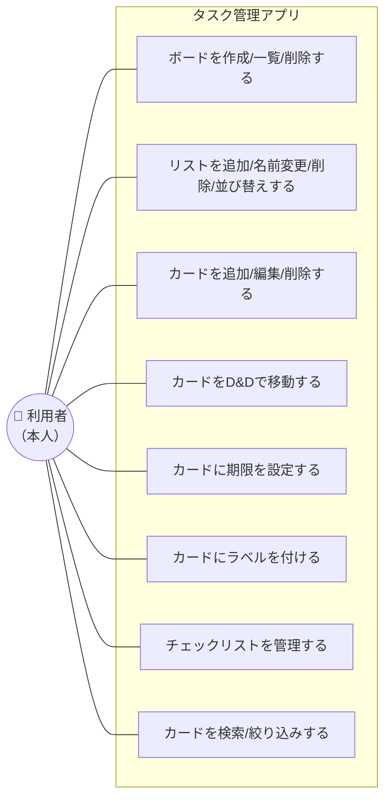
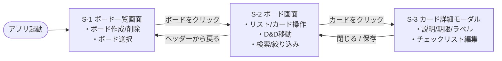
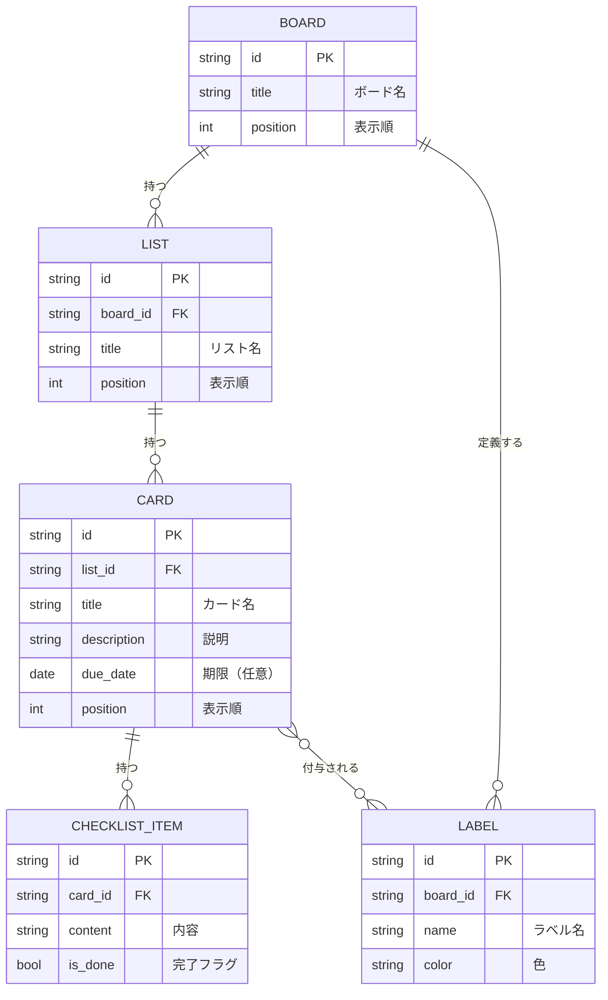

# 要件定義書：Trello風タスク管理アプリ

| 項目 | 内容 |
|------|------|
| アプリ名 | （仮）Trello風タスク管理アプリ |
| 作成日 | 2026-11-09 |
| 目的 | 学習（スクール課題） |
| ステータス | 要件定義 |

## 1. 概要・目的

ボード上でカード（付箋）を動かしながらタスクを視覚的に管理する、Trello風のタスク管理アプリを作成する。
個人のタスク・課題を「未着手／作業中／完了」などの状態で整理し、進捗をひと目で把握できるようにすることを目的とする。

## 2. 想定ユーザー / 利用シーン

- 想定ユーザー：**本人1人**（ログイン・複数人共有は対象外）
- 利用シーン：個人のタスク管理、学習課題やTODOの進捗整理

## 3. スコープ（範囲）

### 3.1 今回作る（MVP）

ボード／リスト／カードの基本管理、ドラッグ&ドロップ、カード詳細、期限、ラベル、チェックリスト、検索・絞り込み。

### 3.2 今回作らない（将来拡張）

ログイン／認証、複数人共有・コラボ、コメント、通知、添付ファイル、モバイルアプリ化、外部連携、デプロイ。

## 4. 用語定義

| 用語 | 意味 |
|------|------|
| ボード(Board) | 作業板。プロジェクト単位のまとまり |
| リスト(List) | ボード内の縦の列。タスクの状態を表す（例：未着手/作業中/完了） |
| カード(Card) | 1件のタスク |
| ラベル(Label) | カードに付ける色付きタグ（分類用） |
| チェック項目(ChecklistItem) | カード内の小タスク |

## 5. ユースケース図

利用者（本人）がアプリで行える操作の一覧。



## 6. 機能要件

| ID | 分類 | 機能 | 概要 |
|----|------|------|------|
| F-01 | ボード | 作成 | 新しいボードを作成できる |
| F-02 | ボード | 一覧表示 | 作成済みボードを一覧で表示できる |
| F-03 | ボード | 削除 | ボードを削除できる |
| F-04 | リスト | 追加 | ボード内にリストを追加できる |
| F-05 | リスト | 名前変更 | リスト名を変更できる |
| F-06 | リスト | 削除 | リストを削除できる |
| F-07 | リスト | 並び替え | リストの表示順を変更できる |
| F-08 | カード | 追加 | リスト内にカードを追加できる |
| F-09 | カード | 編集 | カードのタイトル・内容を編集できる |
| F-10 | カード | 削除 | カードを削除できる |
| F-11 | カード | D&D移動 | カードをリスト内・リスト間でドラッグ移動できる |
| F-12 | カード | 詳細表示 | カードをクリックすると詳細を開ける |
| F-13 | 期限 | 設定・表示 | カードに期限日を設定・表示できる。期限が近い/過ぎたら強調表示 |
| F-14 | ラベル | 付与 | カードに色付きラベルを付与・表示できる |
| F-15 | チェックリスト | 管理 | カード内に小タスクを追加・チェックでき、進捗率を表示する |
| F-16 | 検索 | 検索/絞り込み | キーワードやラベルでカードを検索・絞り込みできる |

## 7. 画面設計

### 7.1 画面一覧

| No | 画面名 | 種別 | 役割 |
|----|--------|------|------|
| S-1 | ボード一覧画面 | ページ | ボードの一覧表示・作成・削除。アプリの入口 |
| S-2 | ボード画面 | ページ | リストとカードを表示。カードのD&D移動・追加・検索/絞り込み |
| S-3 | カード詳細 | モーダル | 説明・期限・ラベル・チェックリストの編集（S-2 に重ねて表示） |

### 7.2 画面遷移図



### 7.3 ワイヤーフレーム

#### S-1 ボード一覧画面

```
┌────────────────────────────────────────────────────────┐
│  Trello風タスク管理                                     │ ← ヘッダー（アプリ名）
├────────────────────────────────────────────────────────┤
│                                                        │
│  マイボード                      [ + 新しいボード ]     │ ← 見出し＋作成ボタン
│                                                        │
│  ┌──────────┐  ┌──────────┐  ┌──────────┐              │
│  │ 仕事      │  │ 学習      │  │ 買い物    │             │
│  │          │  │          │  │          │             │
│  │      [×] │  │      [×] │  │      [×] │             │ ← ボードカード（×=削除）
│  └──────────┘  └──────────┘  └──────────┘              │
│                                                        │
│  （ボードが0件のとき）                                  │
│  まだボードがありません。「新しいボード」で作成しましょう │ ← 空状態メッセージ
│                                                        │
└────────────────────────────────────────────────────────┘
```

| 要素 | 操作 | 動き | 対応機能 |
|------|------|------|----------|
| [ + 新しいボード ] | クリック | その場で名前を入力 → 一覧に追加 | F-01 |
| ボードカード | クリック | そのボードの **S-2** へ遷移 | F-02 |
| [×] 削除 | クリック | 確認のうえボードを削除 | F-03 |
| 空状態メッセージ | 表示のみ | ボードが0件のとき案内を表示 | － |

#### S-2 ボード画面

```
┌──────────────────────────────────────────────────────────────┐
│  ← 戻る    仕事ボード            🔍[ 検索...        ] [ラベル▼] │ ← ヘッダー（戻る/ボード名/検索・絞り込み）
├──────────────────────────────────────────────────────────────┤
│                                                              │
│  ┌─ 未着手 ──────┐  ┌─ 作業中 ──────┐  ┌─ 完了 ────────┐      │
│  │ [✎][×]        │  │ [✎][×]        │  │ [✎][×]        │ ← リスト見出し（名前変更/削除）
│  │               │  │               │  │               │     │
│  │ ┌───────────┐ │  │ ┌───────────┐ │  │ ┌───────────┐ │     │
│  │ │🔴 資料作成 │ │  │ │🟡 設計    │ │  │ │ 環境構築   │ │ ← カード（ラベル色/タイトル）
│  │ │📅 11/12   │ │  │ │ ☑2/5      │ │  │ │           │ │     │   期限/チェック進捗
│  │ └───────────┘ │  │ └───────────┘ │  │ └───────────┘ │     │
│  │ ┌───────────┐ │  │               │  │               │     │
│  │ │ 見積依頼   │ │  │               │  │               │     │
│  │ └───────────┘ │  │               │  │               │     │
│  │               │  │               │  │               │     │
│  │ [ + カード追加]│  │ [ + カード追加]│  │ [ + カード追加]│ ← カード追加
│  └───────────────┘  └───────────────┘  └───────────────┘     │
│                                                [ + リスト追加 ]│ ← リスト追加
└──────────────────────────────────────────────────────────────┘
          ↑ カードはリスト内・リスト間を D&D で移動できる
```

| 要素 | 操作 | 動き | 対応機能 |
|------|------|------|----------|
| ← 戻る / ボード名 | クリック | **S-1** へ戻る | F-02 |
| 🔍 検索 | 入力 | キーワードでカードを絞り込み | F-16 |
| [ラベル▼] | 選択 | ラベルでカードを絞り込み | F-16 |
| [ + リスト追加 ] | クリック | その場で名前入力 → リスト追加 | F-04 |
| リスト見出し [✎] | クリック | その場で名前変更 | F-05 |
| リスト見出し [×] | クリック | 確認のうえリスト削除 | F-06 |
| リスト | D&D | リストの表示順を変更 | F-07 |
| [ + カード追加 ] | クリック | その場で入力 → カード追加 | F-08 |
| カード | クリック | **S-3** カード詳細モーダルを開く | F-12 |
| カード | D&D | リスト内・リスト間で移動 | F-11 |
| カード上の表示 | 表示 | 🔴ラベル色 / 📅期限 / ☑チェック進捗 | F-13,14,15 |

**カード表示の強調ルール**

- 📅 期限が**近い**＝黄色、**過ぎた**＝赤 で強調（F-13）
- ☑ は「完了数/全体数」でチェックリスト進捗を表示（F-15）

#### S-3 カード詳細モーダル

```
      ┌──────────────────────────────────────────────┐
      │  カード詳細                            [ × ]  │ ← 閉じる
      ├──────────────────────────────────────────────┤
      │                                              │
      │  タイトル                                     │
      │  ┌────────────────────────────────────────┐  │
      │  │ 資料作成                                 │  │ ← タイトル編集
      │  └────────────────────────────────────────┘  │
      │                                              │
      │  説明                                         │
      │  ┌────────────────────────────────────────┐  │
      │  │ クライアント向けの提案資料をまとめる      │  │ ← 説明編集（複数行）
      │  │                                        │  │
      │  └────────────────────────────────────────┘  │
      │                                              │
      │  期限    [ 2026/11/12 ▼ ]   🔴期限切れ        │ ← 期限設定＋状態表示
      │                                              │
      │  ラベル  🔴重要  🟡作業中  [ + ラベル ]        │ ← ラベル付与/解除
      │                                              │
      │  チェックリスト              進捗 ☑ 2/5 (40%) │ ← 進捗率表示
      │   ☑ 構成案を作る                              │
      │   ☑ 素材を集める                              │
      │   ☐ 本文を書く                        [×]    │ ← 各項目チェック/削除
      │   ☐ レビュー依頼                      [×]    │
      │   ☐ 修正                              [×]    │
      │  [ + 項目を追加 ]                             │
      │                                              │
      │                        [ 削除 ]   [ 保存 ]    │ ← カード削除/保存
      └──────────────────────────────────────────────┘
          （背景は S-2 ボード画面が薄暗く見えている）
```

| 要素 | 操作 | 動き | 対応機能 |
|------|------|------|----------|
| タイトル / 説明 | 編集 | 内容を変更 | F-09 |
| 期限 | 日付選択 | 期限を設定、近い/過ぎたら強調表示 | F-13 |
| ラベル | 付与/解除 | 色付きラベルを付け/外す | F-14 |
| [ + 項目を追加 ] | クリック | チェック項目を追加 | F-15 |
| チェック項目 ☑ | クリック | 完了/未完了を切替、進捗率を更新 | F-15 |
| [ 削除 ] | クリック | 確認のうえカード削除 | F-10 |
| [ × ] / [ 保存 ] | クリック | モーダルを閉じて **S-2** へ | F-12 |

## 8. データ設計

### 8.1 データ項目（概要）

- **ボード**：タイトル
- **リスト**：タイトル、並び順、所属ボード
- **カード**：タイトル、説明、並び順、所属リスト、期限、ラベル、チェック項目
- **ラベル**：名称、色
- **チェック項目**：内容、完了フラグ

### 8.2 ER図



| 関係 | 意味 |
|------|------|
| BOARD → LIST（1対多） | 1つのボードに複数リスト |
| LIST → CARD（1対多） | 1つのリストに複数カード |
| CARD → CHECKLIST_ITEM（1対多） | 1枚のカードに複数のチェック項目 |
| BOARD → LABEL（1対多） | ラベルはボード単位で定義（ボード内で共有） |
| CARD ⇄ LABEL（多対多） | 1枚のカードに複数ラベル、1つのラベルは複数カードに付く |

※ 多対多（CARD ⇄ LABEL）の実装方法（中間テーブル等）や詳細な型・テーブル定義は「データ設計」フェーズで確定する。

## 9. 非機能要件

| 分類 | 項目 | 要件 |
|------|------|------|
| 性能 | 操作の反応 | カード追加・移動・検索などの操作は、体感で待たずに反映される（目安1秒以内） |
| 性能 | 想定データ量 | 個人利用の範囲（目安：ボード〜10／1ボードあたりカード〜100）で快適に動作する |
| 可用性 | 動作環境 | 自分のPC（ローカル）で動作すればよい。サーバ公開・常時稼働は対象外 |
| 対応環境 | 対応ブラウザ | PCのモダンブラウザ最新版（Chrome / Edge / Firefox / Safari）。IE は対象外 |
| 対応環境 | 画面サイズ | PC画面幅を主対象。スマホ幅でもレイアウトが大きく崩れない程度には最低限対応する（D&D等の操作性はPC前提） |
| データ | 永続化 | リロードしても消えない。保存方式は技術選定で決定 |
| データ | バックアップ | 必須としない（学習用途のため。将来拡張で検討） |
| ユーザビリティ | 操作性 | マウスのD&Dで直感的に操作できる。主要操作はクリック数が少ない |
| ユーザビリティ | 誤操作防止 | 削除（ボード/リスト/カード）は確認のうえ実行する |
| 保守性 | コード | 学習目的として、機能ごとに整理された読みやすい構成とする |
| セキュリティ | 認証 | 1人利用前提のためログイン・権限管理は実装しない |

## 10. 制約・前提

- 技術スタックは本書時点で未定（後続フェーズで決定）
- 1人利用前提のため、権限管理・同時編集は考慮しない
